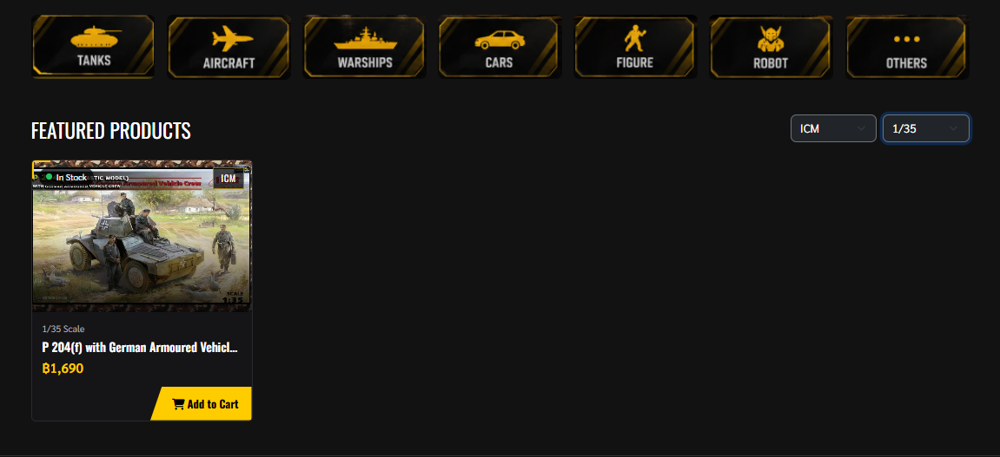
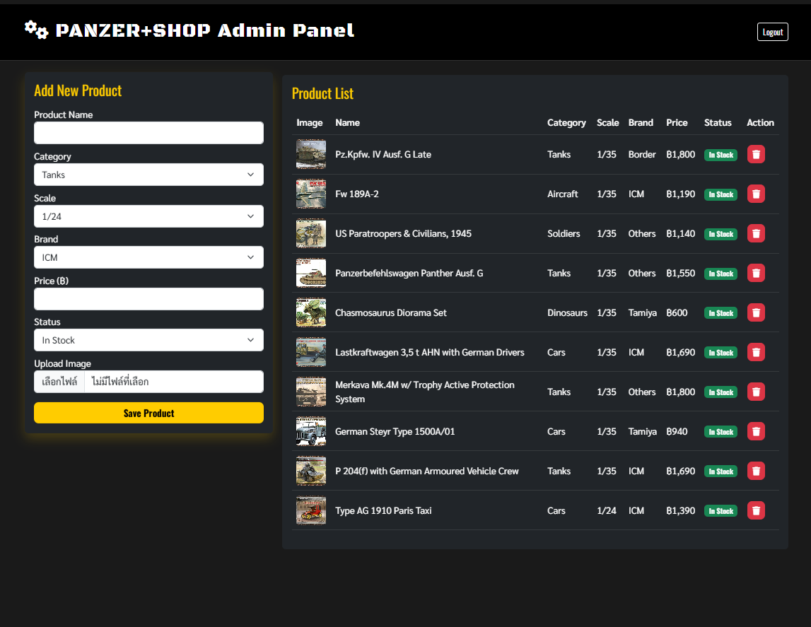

# PANZER+SHOP

A catalog website for a scale-model shop (tanks, aircraft, warships, cars, figures and more), with an admin panel for adding and removing products. It uses **Google Sheets** as the database and **Google Apps Script** as the backend API, so it costs nothing to host.

**Live demo:** https://tungvaraporn-k.github.io/panzershop/

## Screenshots

| Storefront | Category filter | Admin panel |
|---|---|---|
|  |  |  |

## Features

**Storefront**
- Product catalog loaded live from Google Sheets
- Filter by category (Tanks, Aircraft, Warships, Cars, Figure, Robot, Others)
- Status badges (In Stock, Hot, Out of Stock)
- Responsive layout for desktop and mobile

**Admin panel**
- Login with a session token (expires after 6 hours)
- Add products with an image: the image is resized in the browser, then uploaded to Google Drive
- Delete products

## How it works

```
Browser (index.html)
   │  fetch GET  ?action=getProducts
   │  fetch POST {action: login | addProduct | deleteProduct, token, ...}
   ▼
Google Apps Script Web App (apps-script/Code.gs)
   │
   ├──► Google Sheets  — "Products" sheet (the database)
   └──► Google Drive   — "PanzerShop Images" folder (product photos)
```

### Sheet structure (`Products`)

| id | ProductName | Category | Scale | Brand | Price | Status | ImageUrl |
|---|---|---|---|---|---|---|---|

## Security

- Admin credentials are stored in **Script Properties**, never in the source code
- Every write action checks a token stored in `CacheService`
- `LockService` prevents two writes from colliding in the sheet
- User input is trimmed and length-limited, and values starting with `=`, `+`, `-` or `@` are escaped to prevent formula injection
- Category, status and image type and size are validated on the server
- A short delay after a failed login slows down password guessing

## Tech stack

- HTML, CSS, JavaScript, Bootstrap 5
- Google Apps Script
- Google Sheets and Google Drive

## Setup

1. Create a Google Sheet with a `Products` tab and the columns shown above.
2. Open **Extensions → Apps Script**, paste `apps-script/Code.gs`, and set `SHEET_ID` to your sheet's ID.
3. In **Project Settings → Script Properties**, add `ADMIN_USER` and `ADMIN_PASS`.
4. Run `authorizeOnce()` once to grant permissions.
5. **Deploy → New deployment → Web app** (Execute as: Me, Who has access: Anyone).
6. Copy the Web app URL into `API_URL` in `index.html`.
7. Open `index.html`, or host it on GitHub Pages.

## Possible improvements

- Edit existing products
- Shopping cart and order tracking
- Search and sort by price
